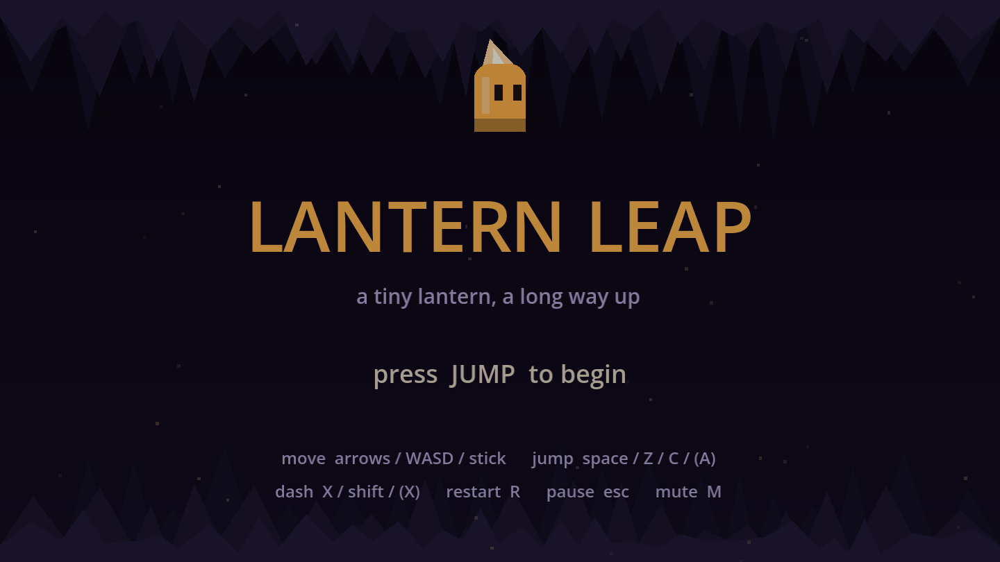
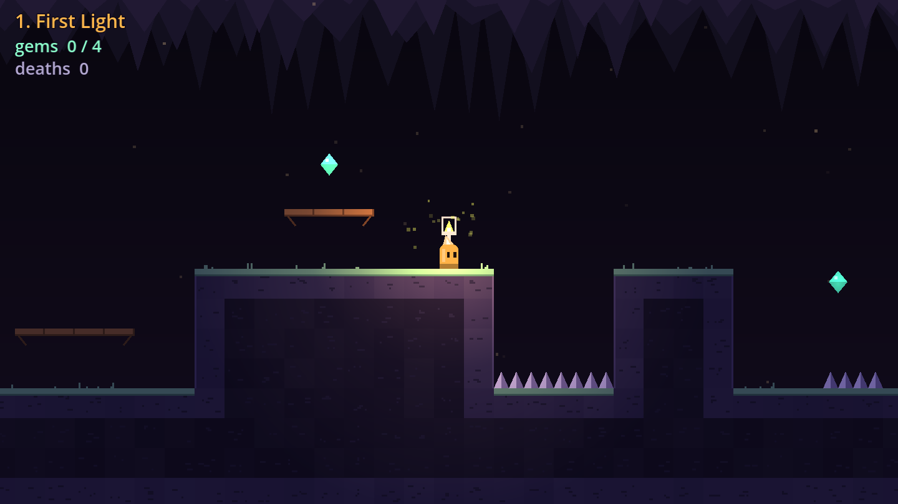
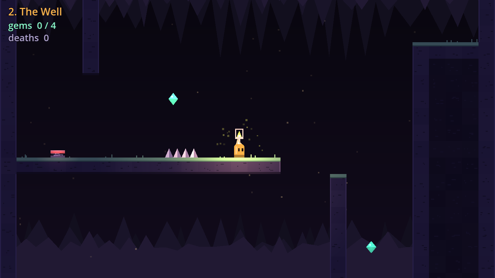
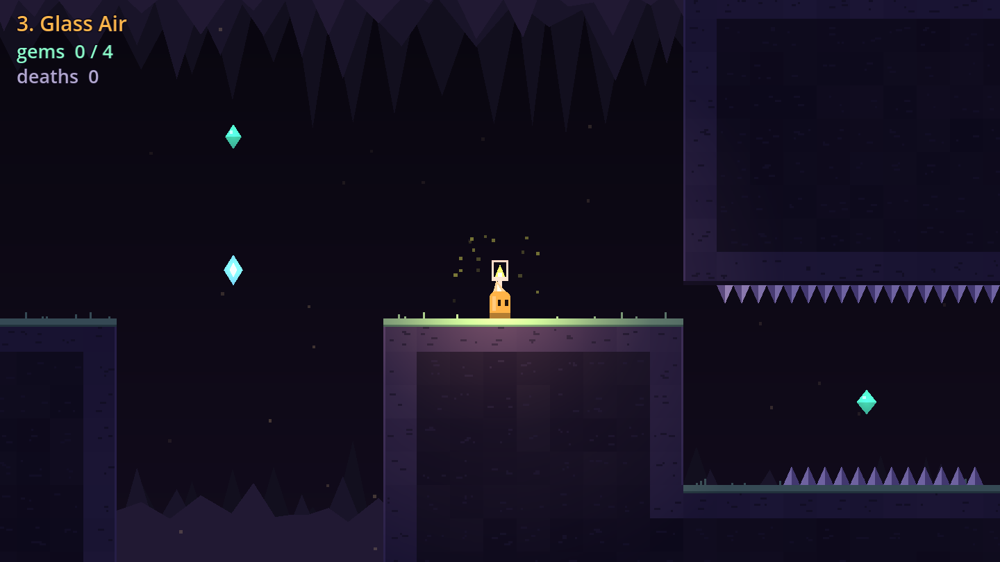
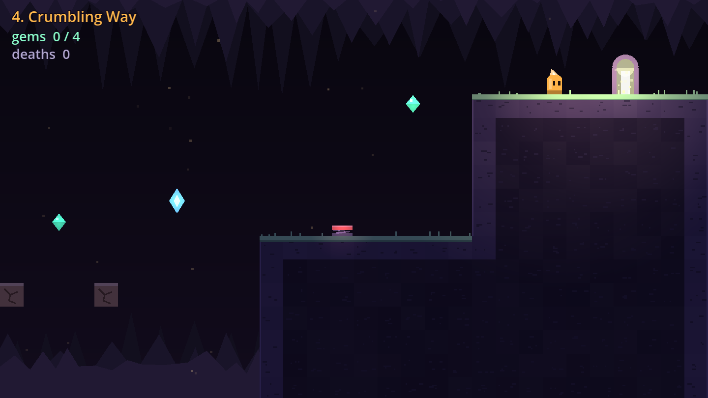

# Lantern Leap

A compact precision platformer made in **Godot 4.7** and exported to the web
(WebAssembly + WebGL 2). You play a small lantern climbing out of a dark cave
across five levels. Each level introduces one mechanic: running and jumping,
wall jumps, the dash, dash crystals, and crumbling blocks.

**[Play it in your browser](https://godfreysdragon.github.io/lantern-leap/)**
(keyboard or gamepad).

The project is a game-feel showcase rather than a content-heavy game. Almost
all of the effort went into how the character *moves and responds*. There are
no art or audio files: every sprite, tile, light and sound effect is generated
in code. The whole game pack is about **90 KB**.



| | |
|---|---|
|  |  |
|  |  |

## Controls

Two keyboard layouts are supported, so movement and actions are always on
separate hands:

| Action | Arrow keys | WASD | Gamepad |
|---|---|---|---|
| Move | Arrows | WASD | Left stick / D-pad |
| Jump (hold for height) | Z | J / Space | A |
| Dash (8 directions) | X | K | X / B / RB |
| Restart from checkpoint | R | R | Back |
| Pause | Esc / P | Esc / P | Start |
| Mute | M | M | |

C (jump) and Shift (dash) are also bound.

## What it demonstrates

### Character controller ([`scripts/player/player.gd`](scripts/player/player.gd))
Every tunable is an `@export`, so the feel can be adjusted live from the
inspector while the game runs.

- **Ledge extensions**: walk off a platform edge and you keep your footing for
  one more tile, so you can still jump. They are invisible one-way ledges that
  the player collides with only while standing, so they never catch a jump or
  a fall ([`level.gd`](scripts/level/level.gd)).
- **Coyote time** (100 ms): a jump pressed just after leaving the ground, or
  the end of a ledge extension, still fires.
- **Jump buffering** (120 ms): a jump pressed just before landing still fires.
- **Variable jump height**: releasing jump early cuts the rise. A buffered tap
  that is already released also gives a short hop.
- **Apex hang**: gravity is halved near the top of a held jump, which makes
  jumps easier to aim.
- **Asymmetric gravity**: you fall faster than you rise, and holding down
  fast-falls.
- **Corner correction**: if your head clips a ceiling edge by up to 5 px, you
  slide around it instead of stopping dead.
- **Wall slide and wall jump**, with wall coyote time and a short input lock
  after the kick. The kick pushes out only half a tile, so you can climb a
  single wall by kicking off it again and again.
- **8-way dash** with a brief hit-stop, after-images and momentum that carries
  out of it. A dash-jump off the ground keeps the dash speed. The dash refills
  on landing, on springs, at crystals and when you touch a wall in the air
  (a new touch only, so you can't chain dashes up one wall).
- **Turnaround boost**: acceleration is higher when you reverse direction, so
  turns feel snappy.

### Feedback ("juice")
- **Squash and stretch** on jump, land (scaled by impact speed), dash, spring
  and respawn ([`player_visual.gd`](scripts/player/player_visual.gd)).
- **Trauma-based screen shake**: strength is trauma², decays over time and is
  driven by smooth noise, with velocity look-ahead on the camera
  ([`game_camera.gd`](scripts/game_camera.gd)).
- **Hit-stop** on death, dash and crystal pickup
  ([`juice.gd`](scripts/autoload/juice.gd)). It is timed against the wall
  clock, so a `time_scale` of 0 can never leave the game stuck.
- **Particles** for dust, skids, wall-slide sparks, landing puffs and death
  bursts. These use `CPUParticles2D` for web compatibility.
- **The character's color is the UI**: amber means a dash is ready, blue means
  it is spent. There is no dash meter.
- **2D lighting**: a dark `CanvasModulate` ambient, the player as the main light
  source, and glowing gems, crystals, springs and checkpoints.
- **Procedural chiptune SFX**: a small synth (square, triangle and
  sample-and-hold noise, with pitch sweeps, vibrato and arpeggios) builds every
  sound into an `AudioStreamWAV` at startup
  ([`sfx.gd`](scripts/autoload/sfx.gd)).

### Level design
Levels are **plain-text ASCII maps** ([`levels/`](levels/)), so they are
diffable and reviewable in a pull request. See [`levels/README.md`](levels/README.md)
for the tile legend and the movement budget used to size the jumps.

Each level has one theme and a cadence of 21 challenges, following Holleman's
*Reverse Design: Super Mario World*. The main challenge is first shown in a
low-stakes warm-up, then grows, changes form and combines with earlier skills.
Other skills appear only as a spot-check or an accumulation:

1. **First Light** is about gaps, and needs only running and jumping. A
   safe dip comes before the first deadly pit. Later gaps get wider and
   higher, spiked ceilings call for short hops, and narrow pillars cut the
   footing down to one tile.
2. **The Well** is about wall jumps: a zig-zag well carved from solid rock,
   so the only walls in reach are the intended ones. It opens with a safe
   single-wall climb and a two-wall shaft over spikes, then a two-wall shaft
   whose exit wall is spiked at the top. Later shafts are wider,
   lined with spikes down one wall, or patched with spikes that make you
   switch walls, and pillars must be climbed to cross pits.
3. **Thorn Pass** is about using the dash to get past spikes a jump can't
   clear. A safe trench, one tile too wide to jump, comes before a spike pit
   of the same width. A low ceiling over a safe dip teaches the flat dash
   before a low ceiling over spikes and spike gates test it, and a ledge over
   a safe floor teaches dashing up before ledges over spikes. There are no crystals: the dash recharges
   only on landing or touching a wall.
4. **Glass Air** is about dash crystals, which refill the dash in mid-air so
   you can stay up longer than one dash allows. It opens with a climb that
   needs the first crystal, over a safe floor. One crystal over a safe dip
   comes before one over spikes, and climbs over a safe floor come before
   climbs over spikes. Later crossings chain up to four crystals, step down,
   climb, run under a spiked ceiling or up a spike-lined chimney.
5. **Crumbling Way** is about blocks that collapse 0.45 s after you touch
   them, starting with a crumbling bridge over a safe dip. It goes on to
   stepping stones, a crumbling pillar (first over a safe dip) and shafts to
   wall-jump up, a trapdoor, and crossings that combine crystals with
   crumbling footing. It is the hardest level.

No crystal can be reached with a jump alone, only with a jump and a dash, so
seeing one always means "dash here".

Hints arrive where they're needed: besides the line shown on entry, a level
can attach a hint to a spot, shown as the player reaches the challenge it
explains and again after a death there.

Clearing a level unlocks the next one in the **level select** (press dash on
the title screen). Each level keeps its own best time and gem count.

Gems are only safe once a **checkpoint** is lit. Dying loses every gem taken
since the last checkpoint, and puts those gems back in the level to collect
again. Gems carried through the exit door count.

The level builder ([`level.gd`](scripts/level/level.gd)) **greedy-merges solid
tiles** into the fewest collision rectangles. This is cheaper and avoids
characters catching on internal tile seams. Spikes **auto-orient** away from
whatever they are attached to. Tile art auto-tiles from neighbors: mossy tops,
rims on exposed sides, darker rock when buried
([`tile_art.gd`](scripts/level/tile_art.gd)).

## Architecture

```
scenes/main.tscn          Main: game loop and state machine (title / playing / paused / clear / finale)
├─ BackgroundLayer        Procedural parallax cave (screen space, wraps horizontally)
├─ World                  ← Level is built here at runtime
│   └─ Level              LevelData → collision + TileArt + entities; re-emits entity signals
│       ├─ entities       Spike, Gem, Spring, DashCrystal, CrumbleBlock, Checkpoint, ExitDoor
│       └─ Player         scenes/player.tscn (CharacterBody2D + Visual + PointLight2D)
├─ Camera (GameCamera)
├─ Hud                    CanvasLayer: timer, gems, deaths, tutorial hint
└─ Screens                CanvasLayer: menus + fade curtain (process_mode ALWAYS)

Autoloads: Save (ConfigFile → IndexedDB on web), Controls (input map in code),
           Sfx (synth), Juice (shake / hit-stop)
```

Entities only emit signals. `Level` re-emits them, and only `main.gd` holds run
state. Best times and gem counts are saved per level and for a full run.

## Running it

Requires [Godot 4.7](https://godotengine.org/download) (standard build, not .NET).

```bash
# Play in the editor
godot --path . -e        # then press F5

# Or run directly
godot --path .
```

### Tests

```bash
godot --headless --path . --import   # first time only, builds the class cache
godot --headless --path . --fixed-fps 120 --quit-after 60000 res://tests/run_tests.tscn
```

[`tests/run_tests.gd`](tests/run_tests.gd) runs 143 checks:

- **Level lint**: exactly one start and one exit, known tiles only, door
  headroom, springs and checkpoints are grounded, hint tips sit in open space.
- **Movement contracts**: these drive the real player scene with synthetic
  input on a deterministic fixed timestep, and check that a full jump clears
  3 tiles but not 4, a tap gives a short hop, a ledge extension holds a
  player who walks off an edge but never one who jumps or falls through it,
  coyote time starts where the extension ends, jump buffering works, the dash covers about 3 tiles and recharges, corner correction slides
  past a ledge, wall slide and wall jump behave, a single wall climbs quickly,
  and touching a wall refills the dash once. Level design depends on
  these numbers, so retuning the controller cannot silently make a level
  impossible.
- **End-to-end**: boots the real main scene, starts from the title, dies and
  respawns, checks that a death loses only the gems not yet banked at a
  checkpoint, then completes every level through its exit door to the finale,
  and replays a level from the level select.
- **Bots**: every level's recorded speedrun still finishes in the real game
  without dying (so the bot data can't silently go stale), bot runs aren't
  saved as best times, and the normal-player bot gets going.

`tools/capture.tscn` renders the screenshots in `docs/screenshots/` and needs a
window.

### Watching bots play

For debugging and playtesting, two bots can play any unlocked level while you
watch. In the level select, press **1** for the speedrun bot or **2** for the
normal-player bot.

- The **speedrun bot** replays the fastest unbroken run found for the level,
  input for input.
- The **normal-player bot** plays live, like a person who hasn't practised: it
  stops on the safe spot before each challenge, lines up, hesitates, then
  tries a known route with human-sized timing errors (about 33 ms), uneven
  jump holds and the odd dash in the wrong direction. It dies, respawns at
  checkpoints and tries again, and waits for crystals and crumbled blocks to
  come back after a fall.

Both drive the real input actions ([`bot_policy.gd`](scripts/debug/bot_policy.gd),
[`bot_driver.gd`](scripts/debug/bot_driver.gd)), and their runs aren't saved
as best times. Their data lives in `debug/bots/<level>.json`: the level's
challenges as segments between safe spots, the routes, and the speedrun.
After changing a level or the movement, update the segments if the safe spots
moved, then regenerate the routes and speedrun (a few minutes per level):

```bash
godot --headless --path . --fixed-fps 120 res://tools/bots.tscn
```

### Web export

```bash
godot --headless --path . --export-release "Web" build/web/index.html
```

The preset uses the **single-threaded** web template, so it runs on any static
host (GitHub Pages, itch.io, Netlify) with no COOP/COEP headers or service
worker. Serve `build/web/` over HTTP; opening the file directly will not work.

[`.github/workflows/web.yml`](.github/workflows/web.yml) installs Godot, runs the
tests, exports the web build and deploys it to **GitHub Pages** on every push to
`main`. To turn it on: Settings → Pages → Source: *GitHub Actions*.

## Adding a level

1. Create `levels/05_whatever.txt` (copy an existing one for the format).
2. Append its path to `LEVELS` in [`scripts/main.gd`](scripts/main.gd).
3. Run the tests. The lint and end-to-end checks pick it up automatically.

## License

[MIT](LICENSE)
