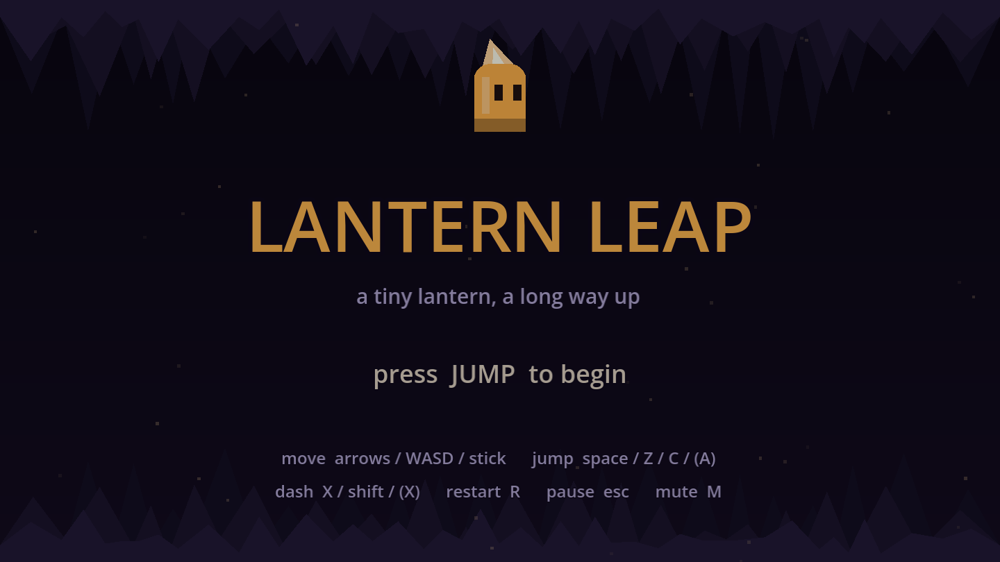
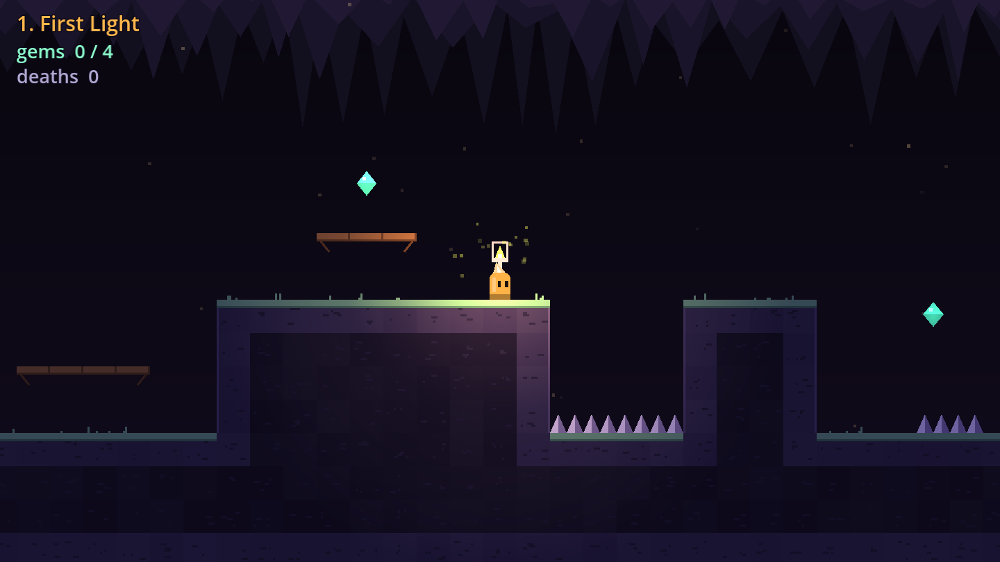
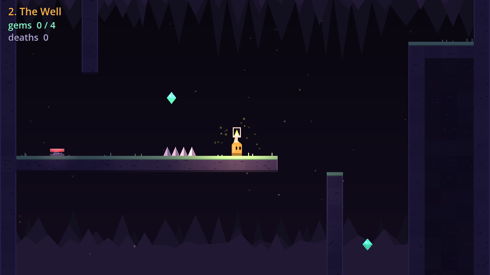
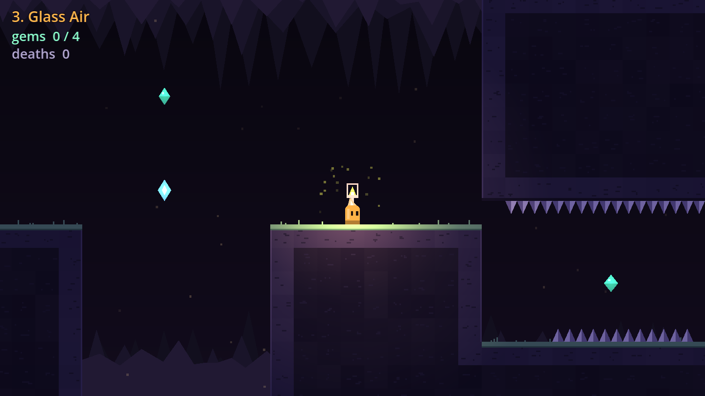
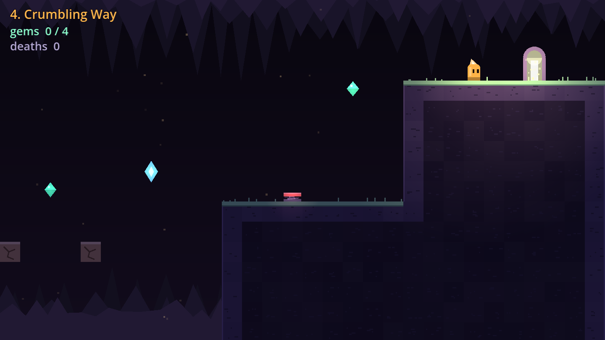

# Lantern Leap

A compact precision platformer made in **Godot 4.7** and exported to the web
(WebAssembly + WebGL 2). You play a small lantern climbing out of a dark cave
across four levels. Each level introduces one mechanic: running and jumping,
wall jumps, the dash, and crumbling blocks.

The project is a game-feel showcase rather than a content-heavy game. Almost
all of the effort went into how the character *moves and responds*. There are
no art or audio files: every sprite, tile, light and sound effect is generated
in code. The whole game pack is about **90 KB**.



| | |
|---|---|
|  |  |
|  |  |

## Controls

| Action | Keyboard | Gamepad |
|---|---|---|
| Move | Arrows / WASD | Left stick / D-pad |
| Jump (hold for height) | Space / Z / C / J | A |
| Dash (8 directions) | X / Shift / K | X / B / RB |
| Restart from checkpoint | R | Back |
| Pause | Esc / P | Start |
| Mute | M | |

## What it demonstrates

### Character controller ([`scripts/player/player.gd`](scripts/player/player.gd))
Every tunable is an `@export`, so the feel can be adjusted live from the
inspector while the game runs.

- **Coyote time** (100 ms): you can still jump just after running off a ledge.
- **Jump buffering** (120 ms): a jump pressed just before landing still fires.
- **Variable jump height**: releasing jump early cuts the rise. A buffered tap
  that is already released also gives a short hop.
- **Apex hang**: gravity is halved near the top of a held jump, which makes
  jumps easier to aim.
- **Asymmetric gravity**: you fall faster than you rise, and holding down
  fast-falls.
- **Corner correction**: if your head clips a ceiling edge by up to 5 px, you
  slide around it instead of stopping dead.
- **Wall slide and wall jump**, with a short input lock after the kick so the
  push-off reads clearly, plus wall coyote time.
- **8-way dash** with a brief hit-stop, after-images and momentum that carries
  out of it. A dash-jump off the ground keeps the dash speed. The dash refills
  on landing, on springs and at crystals.
- **Turnaround boost**: acceleration is higher when you reverse direction, so
  turns feel snappy.

### Feedback ("juice")
- **Squash and stretch** on jump, land (scaled by impact speed), dash, spring
  and respawn ([`player_visual.gd`](scripts/player/player_visual.gd)).
- **Trauma-based screen shake**: strength is trauma², decays over time and is
  driven by smooth noise, with velocity look-ahead on the camera
  ([`game_camera.gd`](scripts/game_camera.gd)).
- **Hit-stop** on death, dash and crystal pickup
  ([`juice.gd`](scripts/autoload/juice.gd)). It is timed against the wall
  clock, so a `time_scale` of 0 can never leave the game stuck.
- **Particles** for dust, skids, wall-slide sparks, landing puffs and death
  bursts. These use `CPUParticles2D` for web compatibility.
- **The character's color is the UI**: amber means a dash is ready, blue means
  it is spent. There is no dash meter.
- **2D lighting**: a dark `CanvasModulate` ambient, the player as the main light
  source, and glowing gems, crystals, springs and checkpoints.
- **Procedural chiptune SFX**: a small synth (square, triangle and
  sample-and-hold noise, with pitch sweeps, vibrato and arpeggios) builds every
  sound into an `AudioStreamWAV` at startup
  ([`sfx.gd`](scripts/autoload/sfx.gd)).

### Level design
Levels are **plain-text ASCII maps** ([`levels/`](levels/)), so they are
diffable and reviewable in a pull request. See [`levels/README.md`](levels/README.md)
for the tile legend and the movement budget used to size the jumps.

1. **First Light** covers running, jumping, gaps, spikes and one-way platforms.
   One-way platforms are the only route up to the plateau.
2. **The Well** is a vertical climb: a wall-jump shaft, then a spring that
   launches you into a second shaft.
3. **Glass Air** brings in the dash. The first gap is one tile too wide to
   jump, so the dash is required. Later sections use crystals to chain dashes
   over long gaps.
4. **Crumbling Way** mixes everything with blocks that collapse 0.45 s after
   you touch them.

The level builder ([`level.gd`](scripts/level/level.gd)) **greedy-merges solid
tiles** into the fewest collision rectangles. This is cheaper and avoids
characters catching on internal tile seams. Spikes **auto-orient** away from
whatever they are attached to. Tile art auto-tiles from neighbors: mossy tops,
rims on exposed sides, darker rock when buried
([`tile_art.gd`](scripts/level/tile_art.gd)).

## Architecture

```
scenes/main.tscn          Main: game loop and state machine (title / playing / paused / clear / finale)
├─ BackgroundLayer        Procedural parallax cave (screen space, wraps horizontally)
├─ World                  ← Level is built here at runtime
│   └─ Level              LevelData → collision + TileArt + entities; re-emits entity signals
│       ├─ entities       Spike, Gem, Spring, DashCrystal, CrumbleBlock, Checkpoint, ExitDoor
│       └─ Player         scenes/player.tscn (CharacterBody2D + Visual + PointLight2D)
├─ Camera (GameCamera)
├─ Hud                    CanvasLayer: timer, gems, deaths, tutorial hint
└─ Screens                CanvasLayer: menus + fade curtain (process_mode ALWAYS)

Autoloads: Save (ConfigFile → IndexedDB on web), Controls (input map in code),
           Sfx (synth), Juice (shake / hit-stop)
```

Entities only emit signals. `Level` re-emits them, and only `main.gd` holds run
state. Best times and gem counts are saved per level and for a full run.

## Running it

Requires [Godot 4.7](https://godotengine.org/download) (standard build, not .NET).

```bash
# Play in the editor
godot --path . -e        # then press F5

# Or run directly
godot --path .
```

### Tests

```bash
godot --headless --path . --import   # first time only, builds the class cache
godot --headless --path . --fixed-fps 120 res://tests/run_tests.tscn
```

[`tests/run_tests.gd`](tests/run_tests.gd) runs 65 checks:

- **Level lint**: exactly one start and one exit, known tiles only, door
  headroom, springs and checkpoints are grounded.
- **Movement contracts**: these drive the real player scene with synthetic
  input on a deterministic fixed timestep, and check that a full jump clears
  3 tiles but not 4, a tap gives a short hop, coyote time and jump buffering
  work, the dash covers about 3 tiles and recharges, corner correction slides
  past a ledge, and wall slide and wall jump behave. Level design depends on
  these numbers, so retuning the controller cannot silently make a level
  impossible.
- **End-to-end**: boots the real main scene, starts from the title, dies and
  respawns, then completes every level through its exit door to the finale.

`tools/capture.tscn` renders the screenshots in `docs/screenshots/` and needs a
window.

### Web export

```bash
godot --headless --path . --export-release "Web" build/web/index.html
```

The preset uses the **single-threaded** web template, so it runs on any static
host (GitHub Pages, itch.io, Netlify) with no COOP/COEP headers or service
worker. Serve `build/web/` over HTTP; opening the file directly will not work.

[`.github/workflows/web.yml`](.github/workflows/web.yml) installs Godot, runs the
tests, exports the web build and deploys it to **GitHub Pages** on every push to
`main`. To turn it on: Settings → Pages → Source: *GitHub Actions*.

## Adding a level

1. Create `levels/05_whatever.txt` (copy an existing one for the format).
2. Append its path to `LEVELS` in [`scripts/main.gd`](scripts/main.gd).
3. Run the tests. The lint and end-to-end checks pick it up automatically.
